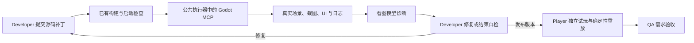

# Developer Godot MCP 接入与运行

本次完成 Developer 的最小接入：源码补丁通过已有构建检查后，公共执行器通过真实 MCP 服务读取场景、启动隔离预览、获取 PNG 和日志；看图模型返回可操作的诊断，Developer 再提交补丁并重新检查。开启方式是 Fixed Loop 的 `--godot-mcp`。没有开启时仍使用原来的 `developer.v3`。

实际服务是固定版本 [godot-mcp-runtime 3.8.1](https://github.com/Erodenn/godot-mcp-runtime)，不是用 MCP 命名的模拟 CLI。依赖及完整性信息锁定在 `configs/godot_mcp/package-lock.json`；受控客户端使用 stdio JSON-RPC，执行初始化、能力检查和工具调用。启动时保存服务返回的版本、工具目录与完整通信记录。此接入属于项目执行服务，不要求在 Codex 应用中额外安装 MCP。

## 工作流程



`developer.v4` 继承 v3 的源码检查、构建错误反馈和 Player 轨迹装配。模型每次返回一个英文 JSON：

- 原有 `DeveloperProposal`：提交源码补丁。构建通过且检查次数未耗尽时，宿主自动预览 `Main.tscn`，优先选择本次补丁声明的第一个场景，等待 60 个 process frame 后截图。
- `inspect`：选择工程内已知的 `.tscn`、已声明的场景和 1–180 帧等待时间，补充一次检查。不传 `scenario` 时走普通入口。
- `finish`：结束自检，说明结果与剩余工作。结束时必须有对应当前工程哈希的检查记录；旧版本截图不能证明新补丁已经检查。

示例检查请求：

```json
{
  "status": "inspect",
  "summary": "Inspect the ordinary title layout after the gameplay preview",
  "inspection": {
    "scene_path": "Main.tscn",
    "scenario": null,
    "frames": 60
  }
}
```

示例结束请求：

```json
{
  "status": "finish",
  "summary": "Reviewed the latest preview after correcting sprite scale",
  "remaining_work": ["Player must independently test movement, interactions and replay"]
}
```

当前 Developer 主模型继续使用原 Chat 接口。它收到场景数据、日志及看图模型的文字解释，不会被提示声称自己看过像素。看图服务收到真实 PNG 字节、原始 instruction 和 MCP 诊断，并输出英文结构化反馈。该服务是 Developer 的工具，不增加第六个角色。

看图服务还接收当前 Art 清单中、源码引用到的最多 4 张实际素材，优先检查多帧图集。`max_visual_asset_images` 可设为 0–7，连同预览图仍受单次最多 8 张、共 8 MiB 的公共限制，超出剩余字节额度的可选素材跳过。引用与哈希由公共执行器校验，图片输入计入现有视觉调用的 token 预算；不会另发模型调用。完整素材 ID、请求的帧布局与实际图片输入保存在 `visual_reviews/` 和 `model_calls/developer_visual/`。请求的网格尺寸不再被描述为已经过像素验证。

反馈区分源素材错误与 Developer 集成错误：卡片、文字、场景地台被烘焙进角色图属于素材问题；有效素材的裁切、缩放、透明度和位置属于代码集成问题。未附带的素材仍未获视觉检查。

`self_review_completed=true` 只表示当前版本的已记录检查均成功、视觉反馈结构有效且模型明确结束了检查流程，不表示画面优秀、玩法正确或可交付。有 mock 美术、剩余工作或未完成自检时，Developer 仍如实标为 partial。检查额度耗尽后继续修改会使先前预览过期；此时不能用旧截图完成自检。

当前工程哈希对应的任一次视觉反馈若仍有 `severity=error`，宿主会将该错误及建议保留在剩余工作中，即使模型 `finish` 返回空列表也保持 partial。需要提交实际补丁并获取新版本检查，才能解除旧版本的错误；普通 warning 不自动阻止角色完成。这是保留开发诊断，不能替代 Player/QA 验收。

## 权限、隔离与预算

| 能力 | 本次范围 |
| --- | --- |
| MCP 调用 | 固定序列：`get_scene_tree`、`run_project`、仅等待的 `simulate_input`、`take_screenshot`、`get_ui_elements`、`get_debug_output`、`stop_project` |
| 模型参数 | 只能选择受校验的场景路径、已声明场景和等待帧数，不能传任意 MCP 工具名、命令、脚本或宿主目录 |
| 修改工程 | 继续通过已有补丁校验和暂存版本流程；不开放 MCP 任意脚本执行或编辑器写入 |
| 容器输入 | 只挂载被检查工程为只读；不挂载整个公开目录、隐藏评分资料、参考解答、`.env` 或 Docker socket |
| 容器输出 | 只可写本次检查子目录；工程在新临时副本中导入并注入上游运行桥接 |
| 运行环境 | 禁网、非 root、只读根文件系统、资源限制、新进程与独立用户数据；超时/取消继承公共容器清理，没有宿主运行回退 |
| 完整性 | 检查前后验证原工程哈希，校验诊断回执、PNG 类型及内容哈希；产物进入原有注册与提交流程 |
| 上游确认 | 保留上游安全扫描，以警告模式运行，避免 strict 对正常 Callable 回调的误阻断；仅回应本次宿主已授权、固定临时工程 `run_project` 的精确启动确认；其他确认或客户端能力请求拒绝 |

每次检查在调用前预留 **7 次工具调用**，成功后按实际 MCP tools/call 数结算；无法确认消耗的失败保留预留。初始化和工具目录发现属于协议握手，所用时间包含在检查预算中。一次检查默认超时 180 秒，默认最多 3 次。看图服务的模型调用、输入图片、输出 token 和时间也经过公共执行器，计入 Developer 与整个运行的预算。

Fixed Loop 和 Scheduler 的正式入口默认开启 [Developer 执行优化](developer_optimization.md)，Developer 最多 11 次主模型决策 + 3 次看图调用，共 14 次模型调用上限；关闭优化恢复 8 + 3。context、inspect、finish 和无效回复纠正也消耗主模型决策次数。不同阶段的实际文件操作、构建与诊断另计工具调用。总预算始终优先；调高 `--max-model-calls` 不会取消 token、时间和其他约束。阶段思考只调整主模型，视觉辅助参数不变。

## Player 和 QA 的复用

公共接口是 `context.tools.inspect_godot(project_ref, request)`，服务通过 `Services.godot_mcp` 注入。

- Developer 可以检查自己的暂存工程或公开的 Developer 工程，发布诊断截图和日志；仍只能提交 build_check 证据，不能提交试玩通过或验收结论。
- Player 已有调用该公共接口的权限，并可检查只读的 Developer 工程。本次 Fixed Loop 的 Player 保留原试玩驱动，没有额外调用 MCP；它会收到当前工程哈希匹配的检查提示，帮助选择试验。
- QA 只读取注册的诊断引用并核对日志哈希。MCP 结果及视觉解释进入 `interpretation` 类型，不携带验收证据 ID，不能单独建立需求通过/失败。QA 不获得 MCP 启动或修改权限。

MCP 预览明确保存 `acceptance_evidence=false` 和 `deterministic_replay=false`。上游桥接会影响临时工程，帧等待与截图并不等同于正式输入轨迹。Player 仍须对交付版本使用原外部驱动采集输入、截图、状态及像素摘要，并在独立进程重放。没有改变单条 600 帧限制、轨迹装配、QA 原始证据校验和最终 ready 条件。

后续比较 Fixed Loop 与 Scheduler 时，两组必须使用相同的角色版本、MCP 开关、服务镜像内容 ID、看图模型、检查次数和公共预算。不能把“有 MCP 的 Loop”和“没有 MCP 的 Scheduler”直接当作调度范式实验。

## 安装与配置

在项目根目录、已启用 Docker 的环境中执行；Linux 与 Windows Docker Desktop 均使用 Linux 容器：

```sh
python -m pip install -e ".[live,test]"
docker build -t gamecraft-godot:4.5.1 configs/godot
docker build -t gamecraft-player:4.5.1 configs/player
docker build -t gamecraft-godot-mcp:4.5.1-mcp3.8.1 configs/godot_mcp
```

前两个镜像已有且与项目一致时只构建第三个。依赖下载发生在构建阶段；运行不联网拉取镜像。MCP 镜像加入 Node 22.21.1 和锁定 npm 依赖，Godot 仍为 4.5.1。更改客户端或包装器后应重建；预检发现镜像内驱动哈希与源码不同会拒绝继续。

本次没有更改 `.env`。可选配置：

```dotenv
GODOT_MCP_IMAGE=gamecraft-godot-mcp:4.5.1-mcp3.8.1
# Default: use the QA gateway/model as the Developer visual tool.
QA_VISION=true
# Optional override; still uses the QA endpoint, key and thinking/stream settings.
DEVELOPER_VISUAL_MODEL=qwen3.8-max
DEVELOPER_VISUAL_MAX_OUTPUT_TOKENS=8192
```

主 Developer 使用 `CODE_DEVELOPER_*`，看图工具默认复用 `QA_*` 的地址、凭据、模型、超时和思考/流式设置；只将视觉输入打开、输出上限设为上述值。替换模型时请选择该网关实际支持图片输入的模型。`DEVELOPER_VISUAL_MODEL` 不改变 QA 本身配置。现有文本调用和 DashScope 原生生图接口保持不变。

先做无在线调用的预检，使用一个新目录：

```sh
python examples/fixed_loop_demo.py --godot-mcp --preflight-only --output runs/fixed-loop-mcp-preflight-001
```

预检验证本地配置与镜像，不验证远端模型的在线可用性。

## 用户在线运行

完整固定 Loop，使用 `.env` 真实聊天模型、看图模型和真实生图服务：

```sh
python examples/fixed_loop_demo.py --godot-mcp --output runs/fixed-loop-mcp-real-images-001 --max-cycles 3 --max-model-calls 64 --max-wall-seconds 18000
```

仅想先验证模型与 MCP 的协作、保留 mock 生图时：

```sh
python examples/fixed_loop_demo.py --godot-mcp --mock-images --output runs/fixed-loop-mcp-mock-images-001 --max-cycles 3 --max-model-calls 64 --max-wall-seconds 18000
```

如果只跑 Developer，可导入已记录的真实 Designer/Art 规划和 mock 图片，调用当前真实 Developer 与看图模型：

```sh
python examples/developer_mcp_demo.py --live --output runs/developer-mcp-live-001
```

三个入口都使用 Benchmark 原始 `platformer-time-loop/instruction.md`。完整 Loop 可沿用 `--task-dir` 指定其他任务；单角色示例固定复用上述任务的已记录上游。不要复用已有输出目录。真实模型效果由这些在线运行验证，本次开发没有发起在线聊天或生图调用。

## 结果目录

完整 Loop 保留原来的 `experiment.json`、`review.md`、`summary.json`、`state_final.json`、`delivery/` 和每次角色输入输出。新增：

| 路径 | 内容 |
| --- | --- |
| `experiment.json → godot_mcp` | 开关、看图模型的公开配置与配置 ID；镜像、驱动、依赖锁哈希在 engines 中 |
| `model_calls/developer/` | 主模型完整请求、回复、流式块、usage |
| `model_calls/developer_visual/` | 看图服务完整请求（含实际图片内容）、回复、usage |
| `model_call_index/<request_id>.json` | 本次 Developer 主调用与看图调用的索引 |
| `workspace/public/artifacts/developer/<invocation>/godot_mcp/<index>/job.json` | 固定检查请求和工程哈希 |
| `…/session/transcript.jsonl`、`server.json` | 完整双向 MCP 通信、初始化结果与工具目录 |
| `…/session/preview.png`、`result.json` | 实际 PNG、场景/UI/调试输出的有界摘要、哈希、使用量和诊断标记 |
| `…/session/import.txt`、`server.stderr.txt`、`…/process.json` | 导入、MCP 服务与容器进程日志 |
| `…/visual_reviews/` | 视觉提示与原始回答，已注册引用 |
| `…/developer_report.json` | 每次检查的工程哈希、结果、截图和视觉反馈、自检完成状态与局限 |
| `implementation_snapshot/` | 本次 Python 源码及 MCP/Player 驱动、Dockerfile 和 npm 锁文件 |

会话失败时先查看 `role_output` 或控制器的角色 result，再查看工具审计和 `workspace/.private/quarantine/` 中的未提交输出；只有事务成功才会发布到 public。完整 MCP 通信保留原文，模型收到有截断标记的摘要。保存整个运行目录供后续诊断，不仅保存最后的游戏工程。不会复制凭据文件或隐藏评测资料。

单角色示例使用 `configuration.json`、`role_input.json`、`role_output.json`、`state_before.json` 和 `state_final.json`，其 `review.md` 提供对应入口；其余 MCP 与模型目录规则一致。

## 本地验证

普通离线测试（使用明确标注的工具/模型夹具）：

```sh
python -m pytest tests/test_godot_mcp.py -q
```

真实本地 MCP/Godot、离线脚本模型、mock 美术的修复示例：

```sh
python examples/developer_mcp_demo.py --offline-fixture --output runs/developer-mcp-offline-new
```

相同真实引擎链路也提供 opt-in 自动断言测试，PowerShell：

```powershell
$env:GAMECRAFT_MCP_ENGINE_TESTS = '1'
$env:GAMECRAFT_MCP_ENGINE_OUTPUT = 'runs/developer-mcp-engine-test-new'
python -m pytest tests/test_godot_mcp_runtime_live.py -q
```

该测试检查两次真实 MCP 调用序列、真实截图不同、修改后的源文件、产物哈希、最后预览与交付工程一致、英文原始 instruction 不变。模型回复是显式夹具，因此通过不代表真实模型已能自动改善 Benchmark 游戏。

也可以只检查一个已有公开游戏工程，不调用任何模型：

```sh
python examples/godot_mcp_inspect.py --project runs/fixed-loop-real-images-003/delivery/game --scenario chapter1_level1 --frames 30 --output runs/godot-mcp-inspect-new
```

本次已保存的完整材料见 [本地验证审阅入口](../runs/godot-mcp-integration-001/review.md)。

## library-first-002 扫描兼容修复

本次真实运行的三次预览均被上游 strict 模式以 Callable 等原语拒绝，导致没有实际视觉反馈。驱动现在移除 strict 开关，继续启用扫描警告和启动确认；未设置 `GODOT_MCP_DISABLE_SECURITY` 或 `GODOT_MCP_DISABLE_ELICITATION`。运行被拒绝后不继续请求不存在会话的输入/截图。日志保留扫描模式与失败原因，外部容器隔离、固定工具和正式重放约束不变。

更新后需重新执行 `docker build -t gamecraft-godot-mcp:4.5.1-mcp3.8.1 configs/godot_mcp`。预检会比较容器内驱动哈希，旧镜像必须重建。已离线验证环境和权限合同，真实 MCP 成功启动仍须服务器验证；不将离线通过描述为已看过游戏。
